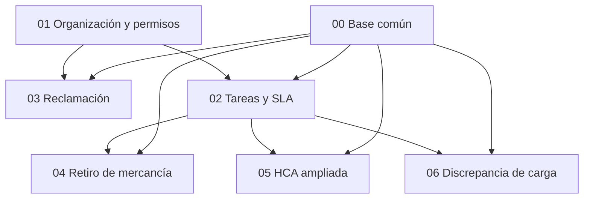

# Plan de construcción · Ampliación por formularios y organización

Panel interno Plastifar · Documento interno · uso confidencial

| | |
|---|---|
| **Versión** | 0.1 (borrador para revisión) |
| **Fecha** | 11 de octubre de 2026 |
| **Complementa a** | `Plan-de-construccion-Plastifar.pdf`, versión 1.0, 2 de septiembre de 2026 |
| **Insumo** | Carpeta `PLASTIFAR_INFO` entregada por Plastifar (cinco hojas de cálculo) |
| **Equipo** | Richard De León · Yordy Acosta |
| **Alcance** | Backend (.NET 10 / PostgreSQL) y frontend (React 19 / Vite / Tailwind 4) |

## 1. Propósito

Plastifar entregó cinco hojas de cálculo con información que debe incorporarse al sistema: cuatro formularios
controlados del sistema de gestión de calidad y un plan de SLA, organización y permisos tomado del sistema
anterior. Al revisarlas se comprobó que no son datos listos para cargar, sino alcance nuevo: describen un flujo
de tareas con formularios obligatorios que el plan original no contempla.

Este conjunto de documentos convierte ese insumo en especificación, con el mismo nivel de detalle del plan
original. Cada documento es un capítulo adicional de ese plan, pero no está subordinado a él en todo: el plan
original fue una maqueta de la idea que tenía el equipo, y las hojas de cálculo describen la operación real de
Plastifar (aclarado por el responsable del proyecto el 11 de octubre de 2026). De ahí la regla de precedencia
que rige estos documentos y que se detalla en la sección 5:

- **En proceso de negocio prevalecen las hojas de cálculo** sobre las secciones 6 a 11 del plan original.
- **Los estándares de ingeniería del plan original siguen vigentes:** las secciones 3, 4, 5 y 12 (metodología,
  estándares obligatorios, uniformidad de diseño y contratos técnicos comunes) aplican aquí sin cambios y no se
  repiten.
- **Donde las hojas de cálculo callan, el punto queda como pregunta abierta,** sin dar por requisito ninguna
  respuesta por defecto.

## 2. Cómo leer estos documentos

Cada afirmación lleva una de tres marcas. La distinción es obligatoria: una propuesta de diseño no es un
requisito del cliente.

| Marca | Significado |
|---|---|
| **[Fuente]** | Lo dice literalmente la hoja de cálculo o el formulario. Se cita la hoja y la celda. |
| **[Propuesta]** | Decisión de diseño de este plan. No la pidió Plastifar; puede cambiar en la revisión cruzada. |
| **[Abierta]** | La fuente es ambigua, contradictoria o no lo define. No se da por requisito ninguna respuesta. |

**Sobre la columna «Se asume mientras tanto».** Las tablas de preguntas abiertas de cada documento llevan esa
columna. Lo que figura en ella es siempre un **supuesto provisional de trabajo de este plan**, anotado solo para
que el documento sea coherente mientras llega la respuesta: no es una regla de Plastifar ni una regla del plan
original, y se sustituye en cuanto el cliente responda. Cuando la columna dice «Ninguno», el plan no toma
partido y lo que dependa de esa respuesta no se construye hasta tenerla.

Los textos de formulario y los valores de catálogo se transcriben tal como aparecen en la fuente, incluida su
ortografía. Cuando la fuente tiene una errata, se señala y se propone el valor corregido al lado; nunca se
corrige en silencio.

Las referencias al código existente (ruta y número de línea) se comprobaron el 11 de octubre de 2026 contra los
árboles de trabajo de `frontend_plastifar` (rama `Feature/yordy`) y `backend_plastifar` (rama `feature/yordy`).
Los números de línea se desplazan con cada cambio; ante la duda manda el nombre del archivo y del símbolo.

## 3. Documentos

| # | Documento | Contenido | Tablas nuevas |
|---|---|---|---|
| 00 | [Base común](00-base-comun.md) | Catálogo de productos, plantas y equipos | `Product`, `Plant`, `Team`, `TeamMember` |
| 01 | [Organización y permisos](01-organizacion-y-permisos.md) | Departamentos, roles, claves de permiso y matriz rol × permiso | Ninguna; amplía `Department` y `Staff`, y añade la baja lógica a `Ticket` y `TicketTask` |
| 02 | [Tareas y SLA](02-tareas-y-sla.md) | Tipos de tarea, SLA por tipo, enrutamiento de formularios y cierre condicionado | `TaskType`, `TaskTypeDepartment`, `TaskTypeAssignee`, `FormRoutingRule`; amplía `TicketTask` |
| 03 | [Reclamación de clientes](03-reclamacion-de-clientes.md) | Formulario PF-FOR-034 | `CustomerClaim`, `CustomerClaimLine`, `CustomerClaimPlant` |
| 04 | [Retiro de mercancía](04-retiro-de-mercancia.md) | Formulario PF-FOR-068 | `MerchandiseWithdrawal`, `MerchandiseWithdrawalLine` |
| 05 | [HCA ampliada](05-hca-ampliada.md) | Formulario PF-FOR-109, como delta sobre el módulo de Calidad existente | `HcaCause`, `HcaParticipant`, `ActionPlanItemAttachment`; amplía `CorrectiveActionSheet` y `ActionPlanItem` |
| 06 | [Discrepancia de carga](06-discrepancia-de-carga.md) | Formulario PF-FOR-291 | `LoadDiscrepancy`, `LoadDiscrepancyLine`, `LoadDiscrepancyCheck` |

Los nombres de tabla son **[Propuesta]** y se cierran en la revisión cruzada.

## 4. Orden y dependencias

| Documento | Depende de | Orden sugerido |
|---|---|---|
| 00 Base común | Nada | 1.º |
| 01 Organización y permisos | Nada | 1.º, en paralelo con 00 |
| 02 Tareas y SLA | 01 (claves `tasks.*`, departamentos) y 00 (equipos) | 2.º |
| 03 Reclamación de clientes | 00 (productos, plantas) y 01 (departamentos de ventas) | 3.º |
| 04 Retiro de mercancía | 00 y 02 | 4.º |
| 05 HCA ampliada | 00 y 02 | 4.º, en paralelo con 04 |
| 06 Discrepancia de carga | 00 y 02 | 5.º |

**Dependencia crítica.** El documento 02 es el que sostiene a los tres formularios que se llenan desde una
tarea (04, 05 y 06). Mientras no exista el tipo de tarea con su formulario obligatorio, esos tres módulos pueden
construirse como registros independientes ligados al ticket, y conectarse a la tarea cuando 02 esté entregado.
Conviene acordar antes el contrato de `TicketTask` para que esa conexión sea un cambio de una línea.

## 5. Relación con el plan original

**Regla de precedencia.** El plan original (PDF v1.0) fue una maqueta: recogió la idea que el equipo tenía del
sistema antes de conocer la operación. Las hojas de cálculo de `PLASTIFAR_INFO` son datos reales de cómo trabaja
Plastifar. El responsable del proyecto lo aclaró el 11 de octubre de 2026, y de esa aclaración sale la regla que
gobierna estos documentos:

1. **Proceso de negocio:** cuando una hoja de cálculo y las secciones 6 a 11 del plan original dicen cosas
   distintas, prevalece la hoja de cálculo. Una regla de negocio del plan original no puede usarse para negar
   algo que la fuente pide.
2. **Estándares de ingeniería:** las secciones 3, 4, 5 y 12 del plan original siguen vigentes sin cambios
   (paginación en servidor, validación espejo, bitácora, fechas en UTC, reglas de interfaz, migraciones
   incrementales, baja lógica por defecto). No son reglas de negocio y las hojas de cálculo no las contradicen.
3. **Silencio de la fuente:** donde las hojas de cálculo no dicen nada, el punto es una pregunta abierta. Una
   regla de negocio del plan original puede figurar como opción, nunca como respuesta por defecto. Si el plan
   necesita un supuesto para ser coherente, se rotula como supuesto provisional de trabajo.

Las reglas de negocio del plan original que el código ya aplica se describen como lo que son: comportamiento
construido. Que sigan vigentes lo decide la respuesta de Plastifar, no el hecho de estar en el PDF.

| Tema | Plan original (PDF v1.0) | Estos documentos |
|---|---|---|
| Estándares, flujo de trabajo y diseño | Secciones 3, 4, 5 y 12 | Se aplican sin cambios |
| Permisos | Sección 6: catálogo de 16 claves | 01 añade claves de tareas y de tickets; 03, 04 y 06 añaden las suyas |
| Catálogos | Sección 8: motivos, SLA, líneas de producto | 00 añade productos, plantas y equipos; 02 añade tipos de tarea |
| Bandeja de tickets | Sección 9, responsable Richard De León | 02 amplía las tareas del ticket; 03 y 04 se llenan al crear el ticket |
| Calidad | Sección 10: HCA y créditos | 05 amplía la HCA; 06 se relaciona con las solicitudes de crédito |
| Reportes | Sección 11: 31 reportes en siete familias | No se planifican en estos siete documentos. La sección 11 debe revisarse: varias de sus familias se apoyan en el SLA por prioridad y en la línea de producto, que los datos reales no confirman. Qué reportes necesita la operación es la pregunta G10 |

**Asignación.** El responsable de cada documento está **por asignar**. El plan original establece que un módulo
lo construye una sola persona y que nadie edita el módulo de otro (sección 3.3). Los documentos 01, 02, 03 y 04
tocan la Bandeja de tickets o sus tareas, que el plan original asigna a Richard De León; cada uno lo señala en su
cabecera. La asignación debe resolverse antes de abrir la primera rama.

**Contradicciones con el plan original resueltas a favor de la fuente.** La matriz de permisos del insumo
incluye «Eliminar — Capacidad de borrar tickets» y «Eliminar — Capacidad de borrar tareas». El plan original
establece que un ticket no se elimina, se cancela (sección 9.4, regla 9). Por la regla de precedencia, el permiso
de la fuente se crea; se implementa como baja lógica auditada, que cumple a la vez el permiso que pide la fuente
y el estándar de ingeniería de baja lógica. Se trata en el documento 01, sección 8, regla 9, y sección 16,
pregunta 4.

**Reglas de negocio del plan original que pasan a pregunta abierta.** La separación entre quien solicita y quien
aprueba (sección 10.3, regla 5), las condiciones de cierre de la HCA (sección 10.3) y la línea de producto como
concepto separado de la planta (sección 8) ya no se dan por decididas: ver la sección 8 de este índice, preguntas
G7 a G9. Lo mismo vale para otras ocho reglas que los documentos tomaban del plan original:

| Regla del plan original | Dónde se usaba | Ahora |
|---|---|---|
| Sección 6.3, reglas 1 a 6 (permiso efectivo y alcance por departamento) | 01, sección 8, regla 8 | Se contrasta cada una con la fuente: las reglas 1 a 3 quedan abiertas (01, preguntas 3, 15 y 16; G11); las 4 a 6 siguen como salvaguardas técnicas |
| Sección 11 (reportes) | Este índice | Pregunta G10 |
| Sección 10.3, regla 1 (un registro de calidad no se elimina), aplicada a la reclamación | 03, sección 8, regla 8 | 03, pregunta 12; G12 |
| Sección 9.8 (404 en lugar de 403) | 03, sección 12 | El código de respuesta sigue como estándar técnico; quién ve una reclamación queda abierto (03, pregunta 13; G11) |
| Sección 8.3, regla 2 (el plazo se copia al crear y no cambia después) | 02, sección 8, regla 3 | 02, pregunta 11 |
| Sección 8, modelo de SLA por prioridad con primera respuesta, aplicado a «RESPUESTA A RECLAMACIONES» | 02, sección 7.3 | 02, pregunta 5: no se asume prioridad ni primera respuesta |
| Sección 9.4, regla 10 (límites de adjuntos) | 05, sección 6 | Las comprobaciones de seguridad siguen como estándar técnico; tipos y tamaños de las evidencias quedan abiertos (05, pregunta 11) |
| «No se elimina», aplicado al retiro y a la discrepancia | 04, regla 9; 06, regla 13 | 04, pregunta 10; 06, pregunta 10; G12 |

## 6. Trazabilidad con los archivos de origen

| Archivo | Hoja | Qué aporta | Documento |
|---|---|---|---|
| `PF-FOR-034 - Formulario Reclamaciones de Clientes-V3-ESP (2).xlsx` | ` Español` | Formulario de reclamación; opciones de planta, motivo y área | 03; opciones de planta en 00 |
| `PF-FOR-068 - Solicitud Retiro de Mercancia (1).xlsx` | `FR-Retiro de Mercancia` | Formulario de retiro | 04 |
| `PF-FOR-109-HCA-Hecho Causa y Acción V0.xls` | `HCA` | Formulario HCA | 05 |
| `PF-FOR-291- Formulario Investigación de Discrepancia de Carga V1 (1).xlsx` | `PF-FOR-291` | Formulario y lista de puntos de seguridad | 06 |
| `PLAN-SLA-PERMISOS-PLASTIFAR.xlsx` | `SLA` | 14 plazos por acción | 02 |
| | `DEPARTAMENTOS` | 38 departamentos | 01 |
| | `PLANTAS` | 16 plantas | 00 |
| | `FORMULARIOS` | 6 reglas de quién llena o ve cada formulario | 02 |
| | `ROLES` | 5 roles | 01 |
| | `PERMISOS` | 20 permisos por rol | 01 |

## 7. Datos del insumo que no se incorporan

Los archivos contienen información que no es definición de formulario ni dato maestro. Se deja constancia de
que existe y de por qué se excluye.

| Dónde | Qué es | Por qué se excluye |
|---|---|---|
| PF-FOR-068, toda la hoja | El archivo es un formulario lleno, no una plantilla: trae una empresa, una fecha, tres líneas de producto y un vendedor | Son datos de un caso real. Solo se toma la estructura del formulario |
| PF-FOR-068, nombres definidos `Conductor`, `Contenido`, `Hora` | Listas en caché de otro formulario (PF-FOR-056, retorno de contenedores) | Ninguna celda del formulario las usa; son residuo de una plantilla copiada |
| PF-FOR-291, hojas ocultas `Costo`, `Hoja3`, `Hoja4`, `Hoja5` | Registro de reclamos de exportación de 2015 con clientes, facturas y montos por despachador | Es historial de negocio, no definición. Sus fórmulas de costo están rotas (`#REF!`) |
| PF-FOR-109, metadatos de SharePoint y logotipo | Listas `Tipo de Anexo` y `Proceso`, y logotipo de otra empresa | La plantilla proviene de otra organización; esas listas no describen la operación de Plastifar |
| `AGENTES`, toda la hoja | Los 101 agentes del sistema anterior | La carga de agentes salió del alcance el 23 de octubre de 2026; el personal se da de alta desde la pantalla de Personal (ver documento 01) |

## 8. Preguntas abiertas que bloquean más de un documento

Cada documento lista las suyas. Estas afectan a varios y conviene resolverlas primero.

La última columna es siempre un supuesto provisional de trabajo de este plan (ver sección 2), nunca una regla
de Plastifar ni del plan original.

| # | Pregunta | Afecta a | Se asume mientras tanto |
|---|---|---|---|
| G1 | Los plazos del SLA están en «DIAS». ¿Son días laborables o días calendario? Opciones: (a) laborables, lo que exige un calendario de jornada y feriados y decidir cuál aplica a cada país; (b) calendario, que es una suma directa de días sin depender de `Holiday`. Ver documento 02, sección 8, regla 4 | 02, 04, 05, 06 | **Ninguno.** El modelo admite las dos; no se calcula ni se promete ningún vencimiento hasta tener la respuesta |
| G2 | ¿De dónde sale el maestro de productos (código y descripción) y cada cuánto cambia? | 00, 03, 04, 05, 06 | Carga inicial por archivo y mantenimiento manual desde Configuración |
| G3 | El rol figura en el agente y en el departamento, y no coinciden. ¿Cuál prevalece? Opciones: (a) el del agente; (b) el del departamento; (c) el más amplio de los dos; (d) el más restrictivo; (e) el del agente en su departamento principal y el del departamento en los demás. Ver documento 01, sección 16, pregunta 3 | 01, 02 | **Ninguno.** Se guardan los dos datos tal como vienen; ningún acceso real se otorga hasta tener la respuesta |
| G5 | Las «firmas» de los formularios, ¿deben capturarse en el sistema o basta imprimir y firmar en papel? | 03, 04, 05, 06 | El sistema registra quién y cuándo; la firma autógrafa se hace sobre la impresión |
| G6 | ¿Las opciones de «Planta Involucrada» del PF-FOR-034 son las mismas plantas de la hoja `PLANTAS`? | 00, 03, 05 | Sí, con la correspondencia propuesta en el documento 00 |
| G7 | ¿La línea de producto es un concepto distinto de la planta? Los datos reales solo muestran plantas; «Flexible», que el plan original cita como línea, no aparece en ninguna hoja de cálculo. Ver documento 00, sección 16, pregunta 3 | 00, 03, 05 | **Ninguno.** El modelo conserva `ProductLine`, que ya existe en el código, y añade la planta, ambos opcionales, para no cerrar ninguna opción |
| G8 | ¿Quien solicita o realiza puede también aprobar? El plan original lo prohíbe para los créditos (sección 10.3, regla 5), pero la hoja `SLA` nombra a la misma persona en «RETIRO DE MERCANCIA» y en «APROBACION DE RETIROS X ERRORES DE ALMACEN». Ver documentos 04 y 06 | 04, 06 | **Ninguno.** La separación no se valida en el servidor hasta tener la respuesta |
| G9 | ¿Qué condiciones gobiernan el cierre: el contenido mínimo del formulario PF-FOR-109 o la puerta de cierre del plan original que el código ya aplica a la HCA? Ver documento 05, sección 16, preguntas 1 y 10 | 02, 05 | Para cerrar la tarea, el contenido mínimo del formulario; la puerta de cierre de la HCA sigue como está construida, sin darla por requisito |
| G10 | ¿Qué reportes necesita la operación real? Los 31 del plan original se pensaron sobre la maqueta. Los datos reales podrían alimentar otros, que se anotan como candidatos y no como requisitos: cumplimiento de plazos por tipo de tarea, discrepancias de carga, retiros de mercancía y satisfacción del cliente en las reclamaciones | Todos; la sección 11 del plan original | **Ninguno.** Estos documentos no planifican reportes; los módulos guardan los sellos de tiempo y los estados que cualquier reporte necesitará |
| G11 | ¿Quién ve qué? El plan original da visibilidad estricta por departamento, con una lectura ampliada para supervisión. Los datos reales marcan cada departamento como PUBLICO o PRIVADO y no dicen qué significa. Ver documento 01, preguntas 6 y 16, y documento 03, pregunta 13 | 01, 02, 03, 04, 05, 06 | Supuesto provisional de trabajo: la visibilidad queda como está construida, por departamento y con herencia hacia los hijos. Que el servidor responda 404 a quien no puede ver un registro es estándar técnico y no depende de esta respuesta |
| G12 | La matriz de permisos concede «Eliminar» solo sobre tickets y tareas. ¿Pueden eliminarse los registros de formulario (reclamación, retiro, HCA, discrepancia)? Si pueden, ¿qué rol lo hace? Ver documentos 03 (pregunta 12), 04 (pregunta 10), 05 (pregunta 10) y 06 (pregunta 10) | 03, 04, 05, 06 | Supuesto provisional de trabajo: ningún formulario tiene eliminación ni clave propia; el registro deja de verse si su ticket recibe la baja lógica del documento 01 |

## 9. Qué hacer cuando algo no está en estos documentos

Se aplica la sección 12.3 del plan original: primero se mira cómo lo resolvió el módulo de Personal; si afecta a
un contrato compartido, se conversa antes de escribirlo; si es una decisión de negocio, se pregunta a Plastifar
en lugar de inventar la respuesta. Lo que se decida se anota en el documento correspondiente y se sube la
versión.
